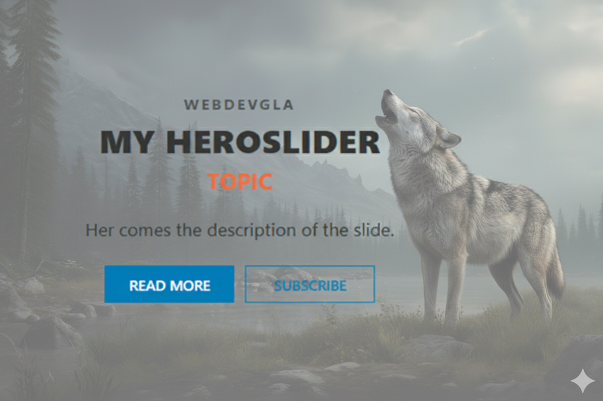

# <span style="display: inline-block; vertical-align: middle;"></span> Gla WebGL Hero Slider - Wordpress

A fancy slider block for the WordPress block editor (Gutenberg) with WebGL transition effects.



---

## 🚀 Live Demo

Check out the interactive live demo deployed on Wordpress Playground:  
👉 **[View Live Demo](https://playground.wordpress.net/?import-site=https://raw.githubusercontent.com/brainmaster1965/gla-webgl-slider-wordpress/main/demo.zip)**

---

|                    |                  |
| ------------------ | ---------------- |
| Version            | 1.1.0            |
| Requires WordPress | 6.8              |
| Requires PHP       | 7.4              |
| License            | GPL-2.0-or-later |

## Key features

- **WebGL transition effects**: 10 shader effects (Displacement, Fluid, Dots, Pixelate, Glitch, Ripple, Zoom Blur, Wave, Dissolve, Swirl), chosen per block in the editor. New effects are just one file in `src/webgl/effects/` (see below). A jump via pagination is always a single transition.
- **Scroll parallax**: the image moves while scrolling (reduced on tablets, off on smartphones).
- **Full width**: breaks out of the content column and uses the full viewport width.
- **Content position per slide**: 9 positions for every single slide (see below).
- **Animated content**: author, title, topic, description and buttons fade in one after the other once the image is revealed.
- **Per slide settings**: image (media library), texts, visible elements, typography (color, size, font family for author, title, topic) and two buttons with colors, hover colors, border radius and outline.
- **Slider settings**: autoplay, interval (3-15 s), pause on hover, transition duration (0.5-3 s), show/hide arrows, pagination and progress bar.
- **Touch and mouse**: swipe/drag, arrows and pagination dots.
- **Accessible**: carousel roles and labels, hidden slides are `inert`, "reduce motion" switches slides instantly without parallax and text animation.
- **Lightweight**: server-side rendering (`render.php`), no jQuery. three.js and the chosen effect are loaded lazily after page load; without WebGL (or with "reduce motion") the slider falls back to a CSS cross-fade. Multiple sliders per page are supported; a single slide shows no arrows, dots or autoplay.

## Content position

Every slide has its own position, chosen with a 3x3 grid in the slide settings.
The value is stored per slide as `contentPosition` (`{vertical}-{horizontal}`):

|            | left          | center          | right          |
| ---------- | ------------- | --------------- | -------------- |
| **top**    | `top-left`    | `top-center`    | `top-right`    |
| **center** | `center-left` | `center-center` | `center-right` |
| **bottom** | `bottom-left` | `bottom-center` | `bottom-right` |

Slides saved with an older version (one alignment for the whole slider) keep their look until a position is chosen for them.

## WebGL effects

```
src/webgl/
  engine.js         three.js stage: canvas, textures, parallax, transition (gsap)
  shaders.js        shared GLSL (getFrom/getTo, noise helpers, uniforms)
  effect-list.js    editor: scans effects/ -> options of the select field
  effect-loader.js  frontend: loads only the chosen effect (own chunk)
  effects/          ONE FILE PER EFFECT
assets/textures/    noise.png, disp.png (helper textures for effects)
```

**Add an effect:** copy `src/webgl/effects/_template.js` to e.g. `my-effect.js` (lowercase, digits, hyphens; the file name is the effect id), implement `vec4 transition(vec2 uv)`, run `npm run build`. It appears in the editor select field automatically. Files starting with `_` are ignored.

Contract: `uProgress == 0` must return exactly `getFrom(uv)`, `uProgress == 1` exactly `getTo(uv)`. Available: `getFrom`, `getTo`, `uProgress`, `uTime`, `uDir`, `uRes`, `uMouse` (pointer position, centre for autoplay), `uNoise`, `uDisp` (list `"noise"` / `"disp"` in `meta.textures`), `fbm`, `vnoise`, `rand2`. Extra uniforms go into `export const uniforms`.

Notes: one WebGL context per slider (browsers allow about 16 per page); the canvas renders on demand only; slide images are downscaled to at most 2560 px for the GPU.

## Getting started

### Install

1. Copy the plugin to `/wp-content/plugins/gla-webglslider` or upload the ZIP via _Plugins > Add New > Upload Plugin_.
2. Activate **Gla WebGL Slider**.

### Use

1. Edit a page or post and open the block inserter.
2. Add **WebGL Slider** from the **Widgets** category.
3. In the sidebar:
   - _General slider settings_: autoplay, interval, hover pause, transition effect, transition duration, arrows, pagination, progress bar.
   - _Manage slides_: per slide image, texts, visible elements, **content position**, typography and buttons. Add or remove slides at the bottom.
4. Check the result on the frontend via the page preview. The editor shows only the first slide, without animation.

### Develop

Node.js and npm are required. The block source is in `src/`, the WebGL part in `src/webgl/`.

```bash
npm install
npm start          # watch mode
npm run build      # production build (writes to build/)
npm run plugin-zip # installable ZIP
npm run lint:js
npm run lint:css
```

```text
gla-webglslider/
├── gla-webglslider.php      # plugin bootstrap, block registration, editor data
├── assets/images/            # demo images
├── assets/textures/          # png texture assets
├── src/webglslider/
│   ├── block.json            # attributes and block metadata
|   ├── index.js              # block's entry point (registers the block)
│   ├── edit.js               # editor UI (sidebar, preview)
│   ├── render.php            # frontend markup (server side)
│   ├── view.js               # frontend logic (WebGL, autoplay, swipe, parallax)
│   ├── style.scss            # frontend + editor styles
│   ├── editor.scss           # editor only styles
│   └── _config.scss          # shared mixins and keyframes
├── src/webgl/effects         # folder with individual shader effect scripts
├── src/webgl/
|   |── effect-list.js        # effect map for the block editor
|   |── effect-loader.js      # effect loader for the frontend
|   |── engine.js             # webgl slider engine
|   |── index.js              # entry of the 'lazy' webgl chunk
|   |── shaders.js            # shared GLSL for every transition effect
└── build/                    # generated by npm run build
```

## Changelog

### 1.1.0

- **New:** autoplay pauses while a slider is not visible (several sliders per page no longer rotate in the background).
- **New:** slide images are lazy loaded; only the first image of the first slider on a page loads eagerly.

### 1.0.0

First stable release. Changes since 0.1.0:

- **New:** content position is set individually for every slide.
- **New:** 9 positions (top / center / bottom x left / center / right) with a 3x3 picker in the slide settings.
- **Changed:** the block-wide "content alignment" setting was removed. Old values are still used as fallback for slides without their own position.
- **Changed:** content layout in frontend and editor preview reworked (shared SCSS mixin); smaller arrows and more side spacing on smartphones.
- **Fixed:** block inserter preview and editor image paths (`window.glawebglsliderData` was never provided).
- **Fixed:** hook order in the editor component (`useBlockProps` is now called before the preview return).
- **Fixed:** new slides had no typography defaults (editor showed `undefinedpx`).
- **Fixed:** bundled image URLs no longer depend on the plugin folder name.
- **Added:** README (txt and md) and LICENSE file.

### 0.1.0

- Initial release with the WebGL Slider block: WebGL transition, scroll parallax, autoplay, swipe, pagination, arrows, progress bar, per slide texts, typography and buttons.

## Demo images

All demo images in `assets/images/` were **generated with Google Gemini (AI)** and are meant as demo content only.
Please check the current terms for generated content before using them in commercial projects.

|                                                               |                                                            |                                                              |
| ------------------------------------------------------------- | ---------------------------------------------------------- | ------------------------------------------------------------ |
|      |  |      |
| `img1.jpg` Wolf                                               | `img2.jpg` Tiger                                           | `img3.jpg` Owl                                               |
|  |  |  |
| `img4.jpg` Elephant                                           | `img5.jpg` Moose                                           | `img6.jpg` Musk ox                                           |

`img99.jpg` is the fallback image for newly added slides, `webglslider-preview.png` is the block inserter preview.

## License

GPL-2.0-or-later, see [LICENSE](LICENSE).
